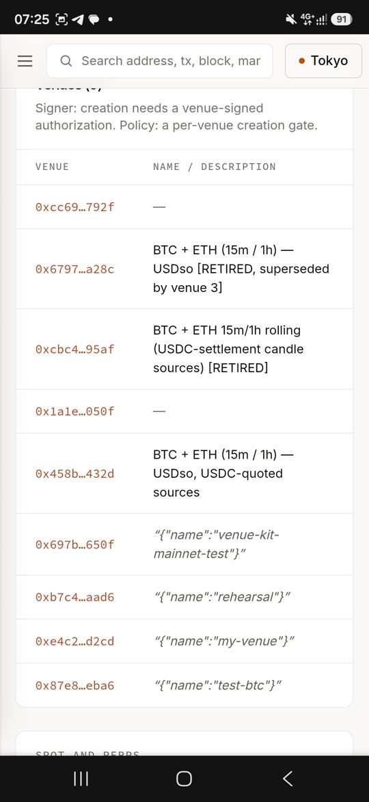
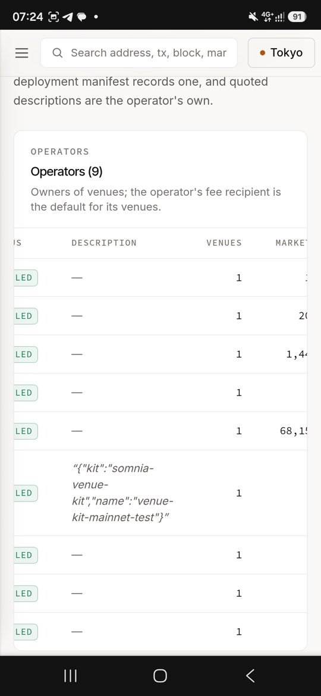

# Explorer /venues: operator and venue descriptions written by the venue kit are shown as raw JSON strings

Severity: normal
Area: app

## Steps to reproduce
1. Open https://explorer.somnia.network/venues with the network switch on **Tokyo**.
2. Scroll to **Operators (9)** and swipe the table to the DESCRIPTION column. Look at operator #6.
3. Scroll to **Venues (9)** and read the NAME / DESCRIPTION column.

## Expected
Metadata that the venue kit writes as JSON is parsed, and the page shows the `name` field as the venue or operator name (for example **rehearsal**, **my-venue**, **test-btc**), with any other keys shown as labelled details. If the explorer chooses not to parse JSON, it should at least show such values in a monospace "raw metadata" style, not as a quoted human description.

## Actual
Four of the nine venues and one operator show the raw JSON text, wrapped in curly quotes and italics, as if it were a sentence the operator wrote:

| Row | Shown as |
|---|---|
| Operator #6 | `"{"kit":"somnia-venue-kit","name":"venue-kit-mainnet-test"}"` |
| Venue 0x697b…650f | `"{"name":"venue-kit-mainnet-test"}"` |
| Venue 0xb7c4…aad6 | `"{"name":"rehearsal"}"` |
| Venue 0xe4c2…d2cd | `"{"name":"my-venue"}"` |
| Venue 0x87e8…eba6 | `"{"name":"test-btc"}"` |

The other venues on the same table show plain-text names ("BTC + ETH (15m / 1h) — USDso, USDC-quoted sources"), so the page already has a name column; it just does not read the structured form. Every venue created with `somnia-venue-kit` gets this format, so the problem grows with each new venue and makes kit-built venues look broken next to hand-registered ones.

## Evidence
- Screenshots: `evidence/explorer-venues/07-venues-full.jpg`, `evidence/explorer-venues/06-venues-url.jpg` (with the URL bar), `evidence/explorer-venues/02-operators-middle.jpg`.
- Taken 2026-11-15 around 06:25 UTC.

## Suggested fix
`try { const m = JSON.parse(desc); if (m && typeof m.name === "string") show(m.name, m) } catch { show(desc) }` in the venue and operator description cells, and the same in the venue detail page header.

## Environment
- Page: https://explorer.somnia.network/venues, network switch: Tokyo
- Device: Android phone, Brave browser, 360 px wide viewport
- SDK: not involved (explorer UI); related package: `somnia-venue-kit`
- Wallet address: not needed (public page)
