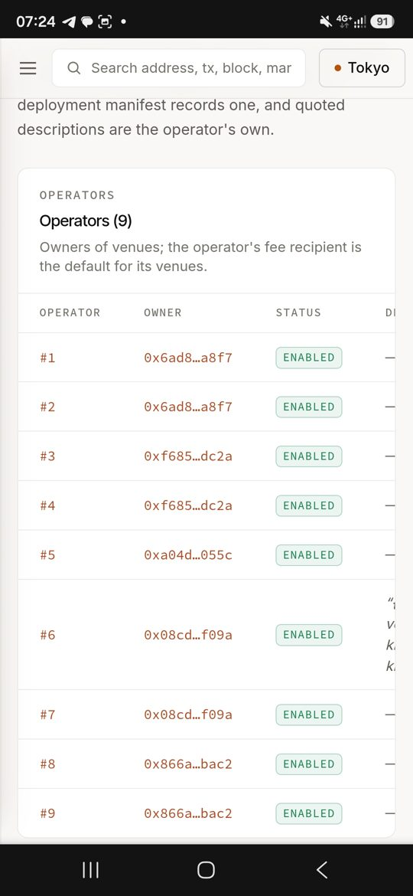
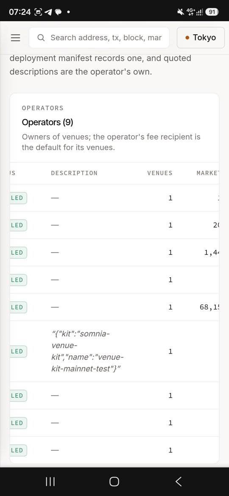
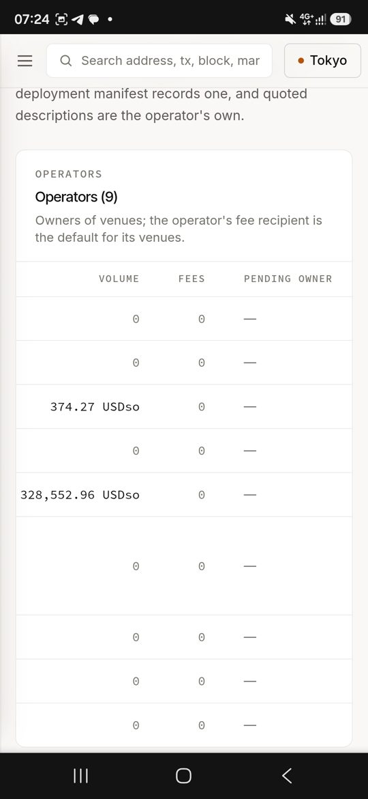
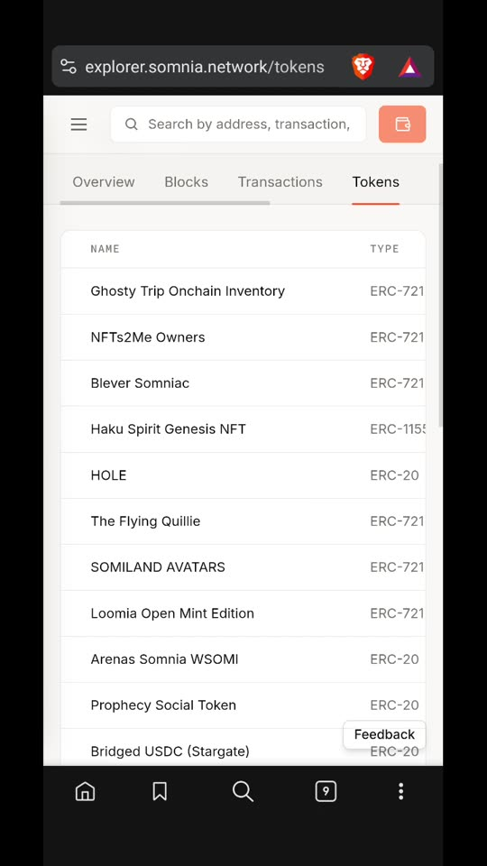
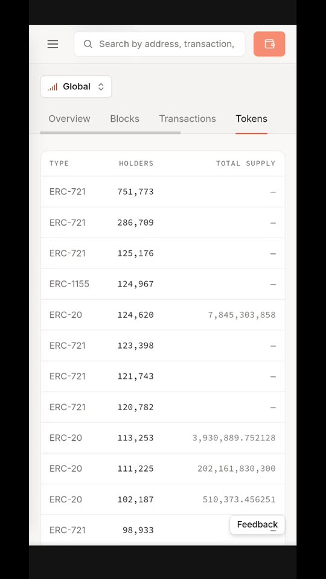

# Explorer tables on a phone (/venues Operators, /tokens): values clipped mid-number, no sign the table scrolls, and the identifying column scrolls away

Severity: normal
Area: app

## Steps to reproduce
1. On a phone (or Chrome device mode at 360 to 390 px wide), open https://explorer.somnia.network/venues with the network switch on **Tokyo**.
2. Scroll to **Operators (9)**.
3. Without scrolling sideways, read the table. Then swipe it left until VOLUME and FEES show.

## Expected
On a narrow screen every column the page shows can be read, and every row can still be tied to its operator. Usual options: a sticky first column (OPERATOR), a stacked card per operator below a breakpoint, or at least a fade or shadow on the right edge to show more columns exist.

## Actual
- **First view:** the table shows OPERATOR, OWNER, STATUS and a header cut to "DI". Nothing shows that 6 more columns (DESCRIPTION, VENUES, MARKETS, VOLUME, FEES, PENDING OWNER) are off-screen.
- **Values are cut mid-number, with no ellipsis or tooltip.** Mid-swipe, the MARKETS column reads "2(", "1,44" and "68,15", and the header reads "MARKET". A reader cannot tell 1,44x from 1,440 or 14,400.
- **The operator column scrolls away.** On the VOLUME / FEES view (the numbers most people come for), no column says which operator a row is. The only way to match "328,552.96 USDso" to operator #5 is to count rows and swipe back.
- **Row heights jump:** operator #6's long description wraps to 4 lines and makes that row about 2× taller in every column, which makes row counting harder.

The Venues table further down the same page fits the screen fine, so this is specific to the 10-column Operators table.

**Same pattern on /tokens** (https://explorer.somnia.network/tokens, Global): on first load the NAME column fits but HOLDERS and TOTAL SUPPLY are off-screen; swipe left to see them and the token NAME column is gone, so a row like "ERC-20 · 124,620 holders · 7,845,303,858" cannot be tied to a token without swiping back. Because one shared table component behaves this way on two pages, a single fix (sticky first column) covers both.

## Evidence
- `evidence/explorer-venues/01-operators-left.jpg` (first view, "DI" header)
- `evidence/explorer-venues/02-operators-middle.jpg` (cut values "2(", "1,44", "68,15")
- `evidence/explorer-venues/03-operators-right.jpg` and `05-operators-right-url.jpg` (VOLUME / FEES view with no operator id; URL visible)
- `evidence/explorer-tokens/tokens-name-view.jpg`, `evidence/explorer-tokens/tokens-scrolled-no-name.jpg` (frames from a screen recording, /tokens, Global)
- Taken 2026-11-15 around 06:24 UTC (/venues) and 11:45 UTC (/tokens).

## Suggested fix
`position: sticky; left: 0` with a background on the first column (OPERATOR, TOKEN) cells and header, plus a right-edge gradient while `scrollLeft + clientWidth < scrollWidth`. Or switch to one card per operator below 640 px.

## Environment
- Pages: https://explorer.somnia.network/venues (network switch: Tokyo), https://explorer.somnia.network/tokens (Global)
- Device: Android phone, Brave browser, 360 px wide viewport
- Wallet address: not needed (public page)
