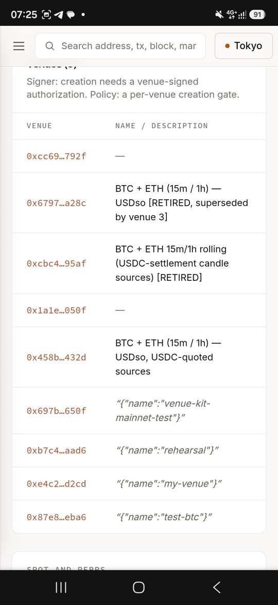

# Explorer /venues: retired venues are marked only inside the free-text description, and "superseded by venue 3" cannot be resolved on the page

Severity: normal
Area: app

## Steps to reproduce
1. Open https://explorer.somnia.network/venues with the network switch on **Tokyo**.
2. Scroll to **Venues (9)** and read the rows for 0x6797…a28c and 0xcbc4…95af.
3. Try to find "venue 3" on the page.
4. Scroll up to **Operators (9)** and read the STATUS column.

## Expected
- A venue's lifecycle state (active / retired) is shown as a status badge, the same way the Operators table already shows ENABLED, and can be filtered or sorted.
- A reference such as "superseded by venue 3" is a link to that venue, or the table shows venue numbers so the reader can find it.

## Actual
- The only sign that a venue is retired is text the operator typed into its description: `BTC + ETH (15m / 1h) — USDso [RETIRED, superseded by venue 3]` and `BTC + ETH 15m/1h rolling (USDC-settlement candle sources) [RETIRED]`. The Venues table has no status column, and venues whose description is "—" give no status at all.
- The Operators table shows **ENABLED** for all nine operators, including the operators behind the retired venues, so the page has two status signals that disagree.
- The Venues table lists venues by address only, with no number. "Venue 3" cannot be matched to a row. If it means the third row in the table (0xcbc4…95af), that venue is itself marked **[RETIRED]**, so the pointer leads to another retired venue.

A trader or bot builder choosing a venue from this page can pick a retired one, because the warning depends on whether an operator happened to type it into a description.

## Evidence
- `evidence/explorer-venues/07-venues-full.jpg`, `evidence/explorer-venues/06-venues-url.jpg` (URL visible), `evidence/explorer-venues/01-operators-left.jpg` (all operators ENABLED).
- Taken 2026-11-15 around 06:25 UTC.

## Suggested fix
Read the venue's on-chain state (or registry flag) into a STATUS badge column, show the venue id in the table, and link "venue N" references in descriptions to `/venues/<address>`.

## Environment
- Page: https://explorer.somnia.network/venues, network switch: Tokyo
- Device: Android phone, Brave browser, 360 px wide viewport
- Wallet address: not needed (public page)
