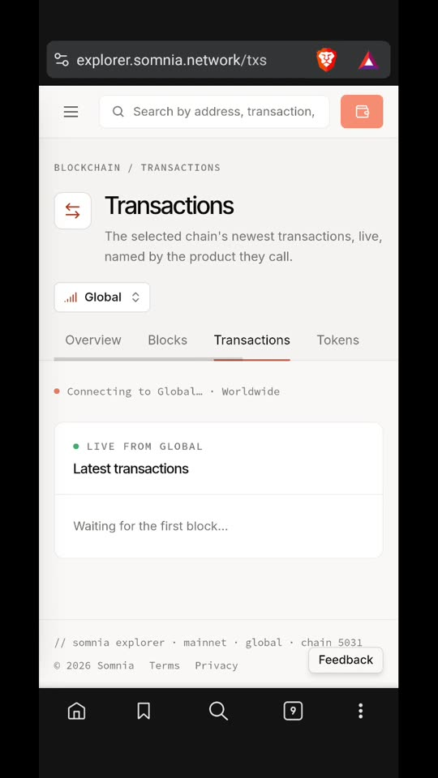
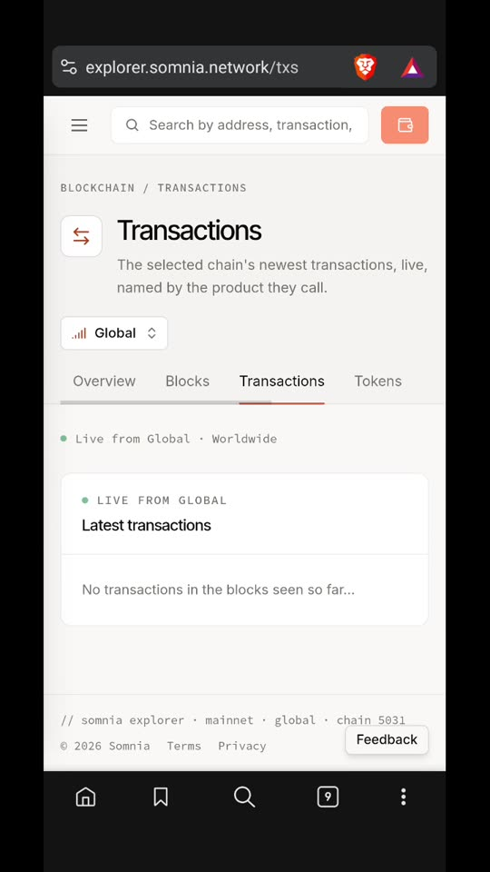
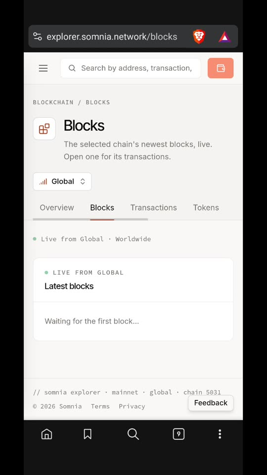

# Explorer /blocks and /txs start empty on every visit and list only what the browser saw since load, with no history, no "Older" paging and no pause

Severity: normal
Area: app

## Steps to reproduce
1. On a phone (or any browser), open https://explorer.somnia.network/blocks with the network switch on **Global**.
2. Watch the "Latest blocks" card for the first few seconds.
3. Open https://explorer.somnia.network/txs and watch "Latest transactions".
4. Switch to another tab (Overview or Tokens) and back to Transactions.
5. Look for a way to see blocks or transactions older than the moment the page opened, or to freeze the list.

## Expected
The dedicated **Blocks** and **Transactions** pages ("The selected chain's newest blocks, live. Open one for its transactions.") show the most recent N blocks / transactions as soon as they load, fetched from the indexer, then prepend live ones. They offer paging to older items, the way `/tokens` already has an **Older ›** button, and a pause control like the one on the Overview page's "Latest events" card, so a row can be tapped before it moves.

## Actual
- On load, `/txs` shows **"Connecting to Global… · Worldwide"** and **"Waiting for the first block…"**, then **"No transactions in the blocks seen so far…"**, on a chain the Overview page reports at **2.4 to 16.4 transactions/s** at the same time.
- `/blocks` shows **"Waiting for the first block…"**, then 1 row, then 4 rows a second later. The list only contains blocks that arrived after the page opened.
- Leaving and returning to the tab resets the list to empty again, so a block or transaction seen a moment ago is gone from these pages.
- Neither page has an **Older** button or any paging, and neither card has a pause control. The Overview page's "Latest events" card does have one (⏸ next to the title). On a phone the rows shift every ~100 ms of block time, so tapping a specific row is hit-and-miss.

So the two pages named "Blocks" and "Transactions" cannot answer "what happened in the last minute" for anyone who just opened them. A user who wants a block from 30 seconds ago has to know its number and search for it.

## Evidence
Frames from a screen recording, Android phone, 2026-11-15 between 11:44 and 11:47 UTC:
- `evidence/explorer-feeds/txs-waiting-first-block.jpg`: /txs "Connecting to Global…", "Waiting for the first block…"
- `evidence/explorer-feeds/txs-no-transactions.jpg`: /txs "No transactions in the blocks seen so far…"
- `evidence/explorer-feeds/blocks-waiting-first-block.jpg` and `blocks-four-rows-one-second-later.jpg`: /blocks filling from zero
- `evidence/explorer-feeds/overview-events-pause-button.jpg`: Overview "Latest events" card with its pause button, for comparison
- `evidence/explorer-tokens/tokens-name-view.jpg` (item 09): /tokens has an **Older ›** pager

## Suggested fix
Seed both lists from the indexer on mount (for example the last 25 blocks / transactions), keep them in a store shared across tabs so switching tabs does not wipe them, add an **Older ›** pager as on `/tokens`, and reuse the Overview feed's pause button (also pause while a finger is on the list).

## Environment
- Pages: https://explorer.somnia.network/blocks, https://explorer.somnia.network/txs (network switch: Global, footer "somnia explorer · mainnet · global · chain 5031")
- Device: Android phone, Brave browser, 360 px wide viewport, mobile data
- Wallet address: not needed (public pages)
